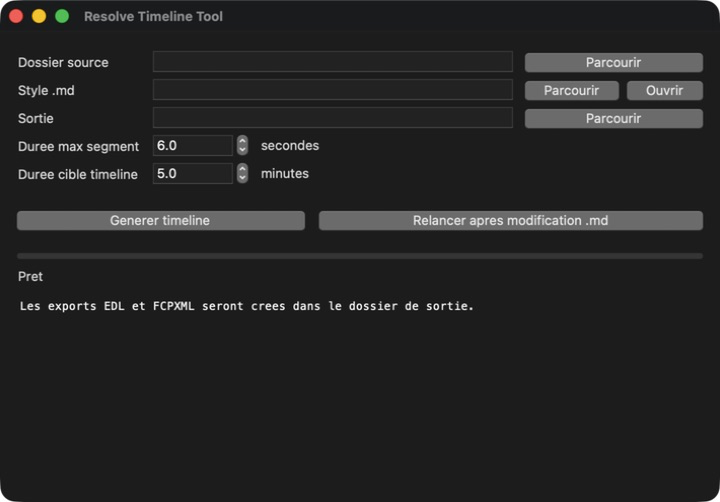

# Resolve Timeline Tool

Prépare automatiquement un premier montage à partir de rushes vidéo et génère une timeline prête à être affinée dans DaVinci Resolve.

L’application analyse un dossier de médias, applique une direction de montage décrite en Markdown, sélectionne des extraits répartis dans le temps et exporte le résultat aux formats EDL et FCPXML.



## Fonctionnalités

- analyse des rushes avec récupération des durées et timecodes intégrés ;
- sélection chronologique d’extraits selon une durée cible ;
- durée maximale configurable pour chaque plan ;
- règles de montage exprimées dans un simple fichier Markdown ;
- placement optionnel des coupes à proximité des beats audio ;
- export `.edl` et `.fcpxml` compatible avec DaVinci Resolve ;
- rapport Markdown détaillant la sélection et les éventuels avertissements.

## Démarrage

Prérequis : Python 3.12 avec Tkinter. FFmpeg est recommandé pour lire précisément les métadonnées vidéo et analyser l’audio.

```bash
git clone https://github.com/anae/ResolveTimelineTool.git
cd ResolveTimelineTool
python3 run.py
```

Sur macOS, le lanceur détecte automatiquement une installation Homebrew de Python 3.12 lorsque le Python système ne permet pas de charger Tkinter.

## Utilisation

1. Sélectionner le dossier contenant les rushes.
2. Choisir le fichier `.md` qui décrit le style de montage.
3. Définir la durée maximale d’un segment.
4. Définir la durée cible de la timeline.
5. Générer la timeline.
6. Importer le fichier EDL ou FCPXML obtenu dans DaVinci Resolve.

Les exports sont enregistrés dans `_resolve_timeline_exports` ou dans le dossier de sortie choisi :

- `.edl` pour un échange EDL simple ;
- `.fcpxml` pour conserver davantage de métadonnées dans Resolve ;
- `_report.md` pour consulter le découpage, les rôles et les avertissements.

## Décrire le style de montage

Le fichier de style peut être rédigé en langage naturel. Quelques paramètres structurés peuvent également être utilisés :

```md
fps: 25
mots-clés drone: drone, DJI, Mavic, aerial
transition drone: 3s
minimum segment: 2s
fenêtre beat: 0.35s
```

Un exemple complet est disponible dans [`STYLE_TEST_RANDO_ALPINISME.md`](STYLE_TEST_RANDO_ALPINISME.md).

## Tests

```bash
python3 -m unittest discover -s tests -v
```

## Stack

Python, Tkinter, FFmpeg/FFprobe, EDL et FCPXML.

Projet conçu par [Elliot Ananaba](https://ananaba.be).
